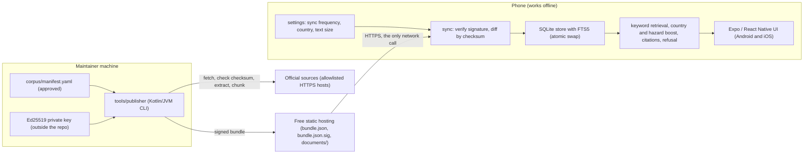

# Mobile and Publisher Design

Status: current. Decision: `docs/adr/0015-offline-mobile-publisher-no-server.md`. Design: `docs/design/offline-mobile-app.md`.

There is no server. The phones work offline from a signed content bundle. The maintainer builds that bundle on a computer with the publisher and uploads it to free static hosting. The apps make one kind of network call: they fetch the bundle from that host.

## Notes

- Trust boundary: the signed bundle. The app rejects any bundle whose signature does not verify and keeps the last good content.
- Updates: the app downloads only documents whose checksum changed, and installs the new content in one swap. A failed or interrupted sync keeps the previous content.
- One codebase: `apps/mobile` (Expo, TypeScript). `src/core` holds the bundle format, signature check, store, retrieval, citations, refusal and sync, with no React Native imports, so it is tested in plain Node.
- The publisher and the app use the same bundle format version (`BUNDLE_FORMAT_VERSION`).
- Out of scope for v1 (spec section 1): live hazard alerts, user accounts, analytics, advertising and payments. No server is part of the design.
