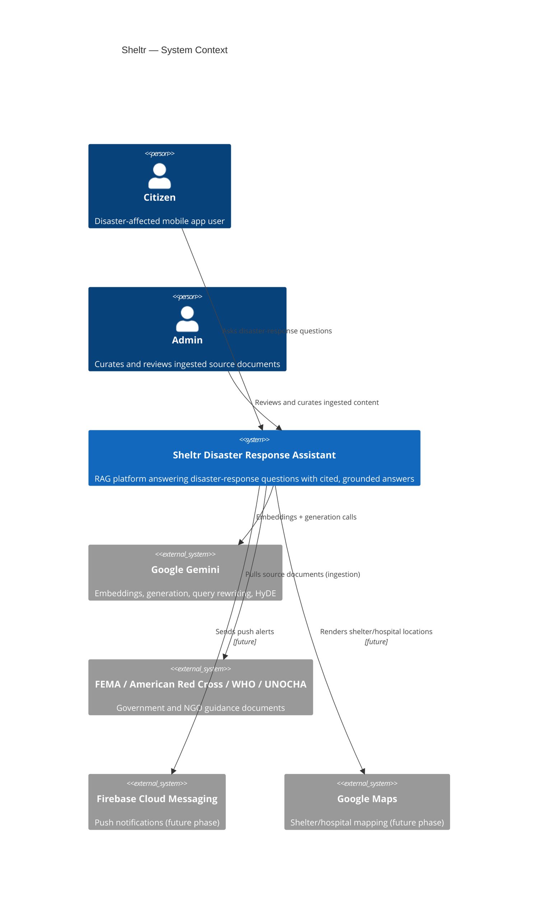
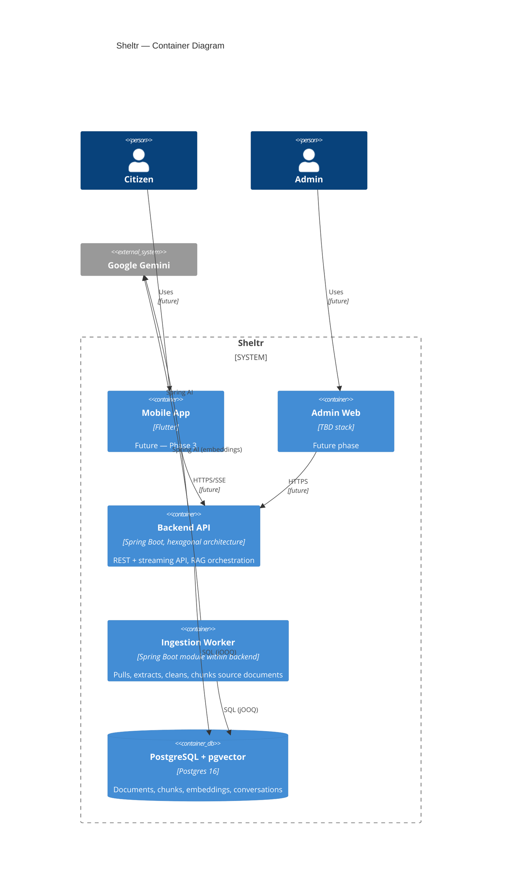

# Sheltr Phase 1 Foundation Implementation Plan

> **For agentic workers:** REQUIRED SUB-SKILL: Use superpowers:subagent-driven-development (recommended) or superpowers:executing-plans to implement this plan task-by-task. Steps use checkbox (`- [ ]`) syntax for tracking.

**Goal:** Stand up the Sheltr monorepo's architectural foundation — repo scaffold, ADRs, C4 diagrams, domain model doc, OpenAPI contract, docker-compose Postgres+pgvector, and a Spring Boot Maven skeleton (empty hexagonal packages, Flyway migrations, Testcontainers migration test) — per `docs/superpowers/specs/2026-07-04-phase1-foundation-design.md`.

**Architecture:** Plain-folder monorepo (no Turborepo/Nx). Backend is one Spring Boot Maven module (`apps/backend`) with Java packages organized per bounded context (`knowledge`, `search`, `ingestion`, `ai`), each split into `domain/application/infrastructure/interfaces/config` sub-packages (hexagonal). No business logic yet — this phase only proves the skeleton compiles, migrations run, and schemas materialize correctly in Postgres+pgvector via a Testcontainers test.

**Tech Stack:** Java 25, Spring Boot 3.5.x, Maven, PostgreSQL 16 + pgvector (`pgvector/pgvector:pg16` image), Flyway 10, jOOQ 3.19 (codegen configured, not yet consumed), Testcontainers 1.20, JUnit 5.

## Global Constraints

- Domain packages must have zero Spring/framework imports (ADR-0002) — this phase only creates empty `package-info.java` markers, so this is trivially satisfied but must stay true going forward.
- No Gemini SDK type may appear outside an `infrastructure` package once AI logic is added in Phase 2 (ADR-0003) — not exercised this phase, noted for the next engineer.
- Every Postgres schema/table name and column must match `docs/superpowers/specs/2026-07-04-phase1-foundation-design.md` Section 6 exactly (`knowledge`, `ingestion`, `ai` schemas).
- No cross-schema foreign key from `ingestion` into `knowledge` (ADR/spec Section 6) — the only cross-schema FK allowed is `ai.citations.chunk_id → knowledge.chunks.id`.
- License: Apache 2.0 (ADR-0009).
- Diagram format: Mermaid only (no PlantUML).

---

### Task 1: Root repo scaffold

**Files:**
- Create: `/Users/giyu/Development/aiprojects/sheltr/.gitignore`
- Create: `/Users/giyu/Development/aiprojects/sheltr/LICENSE`
- Create: `/Users/giyu/Development/aiprojects/sheltr/Makefile`

**Interfaces:**
- Produces: `make up` / `make down` (docker-compose lifecycle, wired to Task 6's compose file), `make build` / `make test` (delegates to `apps/backend`, wired in Task 7).

- [ ] **Step 1: Create `.gitignore`**

```
# Java / Maven
target/
*.class

# IDE
.idea/
*.iml
.vscode/

# OS
.DS_Store

# Flutter (placeholder for Phase 3)
apps/mobile/.dart_tool/
apps/mobile/build/

# Node (placeholder for admin-web)
node_modules/
dist/

# Env
.env
.env.local
```

- [ ] **Step 2: Create `LICENSE`** — standard Apache License 2.0 full text, copyright line:

```
Copyright 2026 Sheltr Contributors
```

(Use the canonical Apache-2.0 license body from https://www.apache.org/licenses/LICENSE-2.0.txt, substituting the copyright line above at the top per the license's own appendix instructions.)

- [ ] **Step 3: Create `Makefile`**

```makefile
.PHONY: up down build test

up:
	docker compose -f infra/docker/docker-compose.yml up -d

down:
	docker compose -f infra/docker/docker-compose.yml down

build:
	cd apps/backend && mvn -q -DskipTests package

test:
	cd apps/backend && mvn -q test
```

- [ ] **Step 4: Commit**

```bash
git add .gitignore LICENSE Makefile
git commit -m "chore: add root repo scaffold (gitignore, license, makefile)"
```

---

### Task 2: Architecture Decision Records

**Files:**
- Create: `docs/adr/0001-monorepo-no-orchestrator.md`
- Create: `docs/adr/0002-hexagonal-architecture.md`
- Create: `docs/adr/0003-gemini-via-spring-ai.md`
- Create: `docs/adr/0004-postgres-pgvector.md`
- Create: `docs/adr/0005-jooq-over-jpa.md`
- Create: `docs/adr/0006-flyway-migrations.md`
- Create: `docs/adr/0007-bounded-context-boundaries.md`
- Create: `docs/adr/0008-mandatory-citation-grounding.md`
- Create: `docs/adr/0009-apache-2-license.md`

- [ ] **Step 1: Write `docs/adr/0001-monorepo-no-orchestrator.md`**

```markdown
# ADR-0001: Monorepo with no build orchestrator

## Status
Accepted

## Context
Sheltr's monorepo spans Maven (backend), Flutter/Dart (mobile), and likely
npm/Vite (admin-web) — three different native build tools. Tools like
Turborepo and Nx are JS-workspace-first; neither natively understands Maven
or Flutter build graphs without wrapper scripts that shell out anyway.

## Decision
Use a plain folder-convention monorepo (`apps/`, `packages/`, `docs/`,
`infra/`). A root `Makefile` provides shared entrypoints (`make build`,
`make test`, `make up`, `make down`) that delegate to each app's native
build tool.

## Consequences
- No caching/affected-detection across apps — acceptable at current scale
  (one backend, mobile/admin-web not yet built).
- Each app's CI job runs independently; no shared task graph to maintain.
- If cross-app build orchestration becomes a real pain point later (e.g.
  shared TypeScript types consumed by both admin-web and mobile web
  builds), revisit with Nx (better polyglot plugin support than Turborepo).

## Alternatives Considered
- **Turborepo**: rejected — JS-first, backend/mobile gain nothing from its
  caching model, adds a tool to learn for no benefit yet.
- **Nx**: rejected for now — same JS-first bias, steeper setup cost than
  justified until there are 2+ JS/TS apps sharing code.
```

- [ ] **Step 2: Write `docs/adr/0002-hexagonal-architecture.md`**

```markdown
# ADR-0002: Hexagonal architecture for the backend

## Status
Accepted

## Context
The backend must support swapping infrastructure (e.g. a different vector
store, a different LLM provider) without rewriting business logic, and
must keep domain logic testable without spinning up Spring or a database.

## Decision
Structure each bounded context as:

```
REST API (interfaces) → Application Services → Domain ← Ports ← Adapters (infrastructure)
```

Domain packages contain zero framework imports (no `org.springframework.*`,
no `org.jooq.*`, no Gemini SDK types). Ports are plain Java interfaces
defined in the domain/application layer; adapters implementing those ports
live in `infrastructure` and depend inward on domain — never the reverse.

## Consequences
- Domain unit tests run with plain JUnit, no Spring context, fast.
- Adding a new persistence technology or LLM provider means writing a new
  adapter, not touching domain/application code.
- More interfaces/indirection than a simple CRUD app needs — justified
  here because the AI provider and vector store are both plausible future
  swap targets (ADR-0003, ADR-0004).

## Alternatives Considered
- **Transaction Script / anemic layered architecture**: rejected — couples
  business rules to Spring/JPA annotations, harder to unit test, harder to
  swap Gemini for another provider later.
```

- [ ] **Step 3: Write `docs/adr/0003-gemini-via-spring-ai.md`**

```markdown
# ADR-0003: Google Gemini only, accessed exclusively through Spring AI

## Status
Accepted

## Context
Product requirement: Gemini is the only LLM provider (no OpenAI, no
Anthropic, no local LLM). At the same time, domain/application code must
not hard-couple to a vendor SDK, per ADR-0002.

## Decision
All Gemini access (embeddings, generation, query rewriting, HyDE,
summarization) goes through Spring AI's portable abstractions
(`ChatModel`, `EmbeddingModel`, etc.). No `com.google.*` Gemini SDK type
may appear outside an `infrastructure` adapter package.

## Consequences
- If Spring AI adds/changes its Gemini starter, only adapter code changes.
- Business logic (e.g. the AI context's `AnswerGenerator` port from the
  domain model) is provider-agnostic in principle, even though the product
  only ever configures Gemini.
- Not exercised in Phase 1 (no AI logic written yet) — this ADR governs
  Phase 2 implementation.

## Alternatives Considered
- **Direct Google GenAI SDK usage**: rejected — couples domain/application
  code to a vendor SDK, violates ADR-0002, makes unit testing AI-dependent
  logic require mocking a concrete SDK class instead of a domain port.
```

- [ ] **Step 4: Write `docs/adr/0004-postgres-pgvector.md`**

```markdown
# ADR-0004: PostgreSQL + pgvector for the vector store

## Status
Accepted

## Context
Need a vector store for chunk embeddings supporting semantic + hybrid
search. Options range from dedicated vector databases (Pinecone, Weaviate,
Milvus) to a Postgres extension (pgvector).

## Decision
Use PostgreSQL with the `pgvector` extension. Embeddings live in the same
database as document/chunk metadata (`knowledge.chunks.embedding` as
`VECTOR(768)`).

## Consequences
- One operational system instead of two — no separate vector DB to deploy,
  monitor, or keep consistent with relational metadata.
- Transactional consistency: a chunk's metadata and embedding are written
  in the same transaction.
- pgvector's ANN indexes (HNSW) are good but not best-in-class at extreme
  scale/QPS compared to dedicated vector DBs — acceptable given the corpus
  is government guidance documents (thousands, not billions, of chunks).
- Revisit if corpus size or query volume outgrows pgvector's practical
  ceiling.

## Alternatives Considered
- **Pinecone/Weaviate/Milvus**: rejected for now — added operational
  surface (another system to run/monitor/secure) not justified at this
  corpus scale.
```

- [ ] **Step 5: Write `docs/adr/0005-jooq-over-jpa.md`**

```markdown
# ADR-0005: jOOQ over JPA/Hibernate for persistence

## Status
Accepted

## Context
Hybrid search and pgvector similarity queries (`ORDER BY embedding <=>
:queryVector`) need precise, typed SQL that JPA/Hibernate's generated
queries and entity-lifecycle model actively fight against. Hexagonal
adapters (ADR-0002) should be thin translators between domain objects and
SQL, not carriers of ORM entity state.

## Decision
Use jOOQ for all persistence adapters. Schema is the source of truth
(Flyway migrations, ADR-0006); jOOQ generates typed query DSL code from
the migrated schema at build time.

## Consequences
- Full control over generated SQL, including pgvector operators and
  `tsvector`/`GIN` hybrid-search queries.
- No entity lifecycle (dirty checking, lazy loading, N+1 surprises) to
  reason about — adapters map explicit rows to domain objects and back.
- Requires a live database (or Testcontainers) to run codegen, unlike
  annotation-driven JPA entities. Mitigated by gating codegen behind a
  Maven profile (`jooq-codegen`) that isn't part of the default build.

## Alternatives Considered
- **JPA/Hibernate**: rejected — ORM entity model doesn't fit
  vector-similarity and hybrid-search query patterns well, and encourages
  anemic-adapter/rich-entity blurring that fights the hexagonal boundary.
- **Plain JDBC**: rejected — no type safety on generated SQL, more
  boilerplate than jOOQ's generated DSL.
```

- [ ] **Step 6: Write `docs/adr/0006-flyway-migrations.md`**

```markdown
# ADR-0006: Flyway for schema migration and versioning

## Status
Accepted

## Context
Need versioned, repeatable schema changes across `knowledge`, `ingestion`,
and `ai` Postgres schemas, applied consistently in dev, CI, and
production.

## Decision
Use Flyway with a single migration location
(`apps/backend/src/main/resources/db/migration`) and a single, globally
ordered version sequence (`V1`, `V2`, `V3`, ...) even though migrations
target different Postgres schemas. Each migration issues its own `CREATE
SCHEMA IF NOT EXISTS` and schema-qualified DDL.

## Consequences
- One `flyway_schema_history` table tracks the whole database's evolution
  — simpler operationally than per-schema history tables, at the cost of
  interleaving unrelated contexts' migrations in one numeric sequence.
- Flyway runs automatically on Spring Boot startup (`spring.flyway.enabled:
  true`), so `make up` + starting the backend always leaves the DB at the
  latest schema.

## Alternatives Considered
- **Per-schema Flyway configurations with separate history tables**:
  rejected for Phase 1 — more moving parts (multiple `FluentConfiguration`
  beans) for a benefit (independent context migration ordering) that
  doesn't matter until contexts are deployed as separate services.
```

- [ ] **Step 7: Write `docs/adr/0007-bounded-context-boundaries.md`**

```markdown
# ADR-0007: Bounded context boundaries and Phase 1 scope

## Status
Accepted

## Context
The product spans 11 candidate bounded contexts: Knowledge, Search,
Disaster, User, Location, Emergency, Notification, Administration,
Analytics, AI, Ingestion. Designing and building all 11 up front, before
any of them has a working implementation to validate the model against,
risks over-designing contexts whose real requirements aren't known yet
(Notification, Analytics, Administration in particular).

## Decision
Full DDD design (aggregates, value objects, domain events, repository
ports) in Phase 1 covers only the 4 contexts Phase 2 actually implements:
**Knowledge**, **Search**, **Ingestion**, **AI**. The remaining 7 contexts
get a one-paragraph stub (name, responsibility, a guess at a future root
entity) in `docs/architecture/domain-model.md`, with full design deferred
to whichever phase implements them.

## Consequences
- Phase 1's domain model doc is smaller and more accurate — it describes
  code that's about to be built, not speculative future code.
- Contexts like User, Location, Notification will need their own design
  pass (own mini brainstorm) before their implementing phase starts.

## Alternatives Considered
- **Full design for all 11 now**: rejected — most of that design would be
  invalidated or reworked once real requirements (e.g. what the mobile app
  actually needs from Location) are known.
```

- [ ] **Step 8: Write `docs/adr/0008-mandatory-citation-grounding.md`**

```markdown
# ADR-0008: Citation-grounded generation is mandatory and structurally enforced

## Status
Accepted

## Context
Sheltr answers disaster-response questions. An invented (hallucinated)
answer about water safety, medication storage, or evacuation is a
safety hazard, not just a quality bug. Relying solely on a prompt
instruction ("always cite sources") is not a strong enough guarantee —
LLMs can and do ignore prompt instructions under some conditions.

## Decision
The AI context's `AnswerGenerator` domain service enforces this in code,
not just in the prompt: if retrieval (Search context) returns zero chunks
above a relevance threshold, `AnswerGenerator` returns a `NoAnswerAvailable`
result and never invokes the LLM to produce a free-form answer. Every
`Message` with role `ASSISTANT` that does reach a user carries a non-empty
`citations: List<Citation>`.

## Consequences
- A "no relevant guidance found" response is an explicit, testable domain
  outcome, not an LLM-dependent behavior.
- Answer-confidence scoring (`AnswerConfidence`) and citation attachment
  are unit-testable against the domain service directly, without calling
  Gemini in the test.
- Some genuinely answerable questions may get a "no answer" response if
  retrieval's relevance threshold is miscalibrated — this is an accepted
  tradeoff (a wrong "I don't know" is far safer than a wrong invented
  fact) and the threshold is tunable.

## Alternatives Considered
- **Prompt-only grounding instruction**: rejected as the sole mechanism —
  not verifiable/testable, and not a strong enough guarantee for
  safety-critical content.
```

- [ ] **Step 9: Write `docs/adr/0009-apache-2-license.md`**

```markdown
# ADR-0009: Apache License 2.0

## Status
Accepted

## Context
Sheltr is open source. Needed a license that: grants an explicit patent
license (relevant given multiple potential contributors and enterprise
adopters), is widely understood/accepted by enterprises wanting to deploy
or contribute, and is consistent with the license of major dependencies in
this stack (Spring, much of the Google ecosystem).

## Decision
License the project under Apache License 2.0.

## Consequences
- Permissive — downstream users may create proprietary derivatives; no
  copyleft obligation to publish modifications.
- Explicit patent grant reduces patent-litigation risk for adopters,
  compared to MIT.

## Alternatives Considered
- **MIT**: rejected — simpler but no patent grant clause, weaker
  protection for an enterprise/humanitarian-adoption context.
- **AGPL-3.0**: rejected — copyleft could deter enterprise or government
  adopters from integrating Sheltr into their own systems, which works
  against the goal of wide humanitarian-guidance distribution.
```

- [ ] **Step 10: Commit**

```bash
git add docs/adr/
git commit -m "docs: add Phase 1 architecture decision records (ADR-0001..0009)"
```

---

### Task 3: C4 diagrams (System Context + Container)

**Files:**
- Create: `docs/diagrams/system-context.mmd`
- Create: `docs/diagrams/container.mmd`
- Create: `docs/architecture/c4.md`

- [ ] **Step 1: Write `docs/diagrams/system-context.mmd`**



- [ ] **Step 2: Write `docs/diagrams/container.mmd`**



- [ ] **Step 3: Write `docs/architecture/c4.md`**

```markdown
# C4 Diagrams — Phase 1 (Context + Container)

Component-level diagrams are deliberately deferred until Phase 2 backend
code exists, to avoid diagrams drifting from an implementation that
hasn't been written yet.

## System Context


See `docs/diagrams/system-context.mmd` for the Mermaid source. Actors:
Citizen, Admin. External systems: Google Gemini, source agencies (FEMA,
American Red Cross, WHO, UNOCHA), Firebase Cloud Messaging (future),
Google Maps (future).

## Container


See `docs/diagrams/container.mmd` for the Mermaid source. Containers
tagged `future` (Mobile App, Admin Web) are not built in Phase 1 — shown
for completeness only. The one real container built this phase is the
Backend API (Spring Boot, hexagonal) plus its PostgreSQL + pgvector
database. The Ingestion Worker is a logical container inside the same
Maven build in Phase 1; whether it splits into a separately deployable
service is an open question, revisited once real ingestion
volume/latency is known (see `docs/adr/0007-bounded-context-boundaries.md`).
```

- [ ] **Step 4: Commit**

```bash
git add docs/diagrams/ docs/architecture/c4.md
git commit -m "docs: add Phase 1 C4 context and container diagrams"
```

---

### Task 4: Domain model documentation

**Files:**
- Create: `docs/architecture/domain-model.md`

- [ ] **Step 1: Write `docs/architecture/domain-model.md`**

```markdown
# Domain Model — Phase 1

Full source of truth: `docs/superpowers/specs/2026-07-04-phase1-foundation-design.md`, Section 5.

## 5.1 Knowledge context (core domain — full design)

Responsibility: canonical store of processed documents, chunks, and embeddings; versioning
and deduplication.

**Aggregate: `KnowledgeDocument`** (root)
- `id: DocumentId`, `title`, `sourceAgency`, `sourceUri`, `disasterTypes: Set<DisasterType>`,
  `publishedDate`, `version: DocumentVersion`, `checksum: Checksum`,
  `supersedes: Optional<DocumentId>`, `status: DocumentStatus` (ACTIVE, SUPERSEDED, RETRACTED)

**Aggregate: `Chunk`** (root — deliberately a separate aggregate from `KnowledgeDocument`,
not an entity nested inside it)
- `id: ChunkId`, `documentId: DocumentId` (cross-aggregate reference, not an object graph),
  `content: ChunkContent`, `embedding: Embedding`, `pageNumber: Optional<PageNumber>`,
  `chunkIndex: int`, `metadata: ChunkMetadata` (section heading, inherited disaster types,
  checksum)

Rationale for splitting `Chunk` out as its own aggregate: retrieval (Search context) queries
chunks directly via vector similarity at scale — loading a full `KnowledgeDocument` aggregate
(potentially hundreds of chunks) on every vector search hit would be wasteful. This also
implements the "Parent Document Retrieval" requirement cleanly: a chunk is fetched via vector
search, then the parent `KnowledgeDocument` is optionally fetched by `documentId` only when
full-document context is needed.

**Domain events**: `DocumentIndexed`, `DocumentSuperseded`, `DocumentRetracted`,
`ChunkEmbedded`

**Value objects**: `DocumentId`, `ChunkId`, `ChunkContent`, `Embedding`, `PageNumber`,
`ChunkMetadata`, `DocumentVersion`, `Checksum`, `DisasterType` (enum: EARTHQUAKE, FLOOD,
HURRICANE, TORNADO, TSUNAMI, WILDFIRE, EXTREME_HEAT, WINTER_STORM)

**Repositories (ports)**: `KnowledgeDocumentRepository`, `ChunkRepository`

## 5.2 Ingestion context (core domain — full design)

Responsibility: pull source content from external agencies, extract, clean, checksum,
version, chunk, hand off to Knowledge.

**Aggregate: `SourceDocument`** (root)
- `id: DocumentId`, `sourceUri: SourceUri`, `sourceType: SourceType` (PDF, HTML, MARKDOWN,
  TEXT, RSS_ITEM), `checksum: Checksum`, `version: DocumentVersion`,
  `status: IngestionStatus` (DISCOVERED, DOWNLOADED, EXTRACTED, CLEANED, CHUNKED, INDEXED,
  FAILED), `metadata: DocumentMetadata` (title, publishedDate, agency, disasterTypes,
  language)

**Domain events**: `DocumentDiscovered`, `DocumentDownloaded`, `DocumentContentChanged`
(fired when checksum differs from the prior version — triggers re-indexing),
`DocumentIngestionFailed`, `DocumentChunked`

**Value objects**: `DocumentId`, `SourceUri`, `Checksum`, `DocumentVersion`,
`DocumentMetadata`, `IngestionStatus`, `SourceType`

**Repository (port)**: `SourceDocumentRepository`

**Connector abstraction (port)**: `SourceConnector` — `fetch(SourceDescriptor): RawContent`.
Per-agency adapters (`FemaConnector`, `RedCrossConnector`, `WhoConnector`,
`UnochaConnector`) implement this port. This is what makes adding a new data source a matter
of writing one new adapter, not touching the pipeline.

## 5.3 Search context (supporting domain — intentionally service-heavy, not aggregate-heavy)

Responsibility: retrieval orchestration — semantic search, hybrid search, metadata
filtering, multi-query retrieval, HyDE, cross-encoder re-ranking, context compression.

This context holds no persistent aggregate root in Phase 1. This is a deliberate DDD
strategic classification choice (Search is a supporting subdomain, not the core domain) and
not an oversight or anemic-model gap: retrieval results are transient by nature, so modeling
them as persisted aggregates would be modeling data that doesn't need to outlive a request.

**Domain concepts** (value objects + domain service ports):
- `SearchQuery` (VO: raw text, filters — disaster types, agency, date range)
- `Retriever` (port, strategy interface) — implementations: `SemanticSearchRetriever`,
  `HybridSearchRetriever`, `MultiQueryRetriever`, `HyDERetriever`
- `RankedResult` (VO: chunk reference, score, rank)
- `ReRanker` (port — cross-encoder re-ranking adapter)
- `ContextCompressor` (port — reduces retrieved chunks to relevant snippets before prompt
  assembly)

## 5.4 AI context (core domain — full design)

Responsibility: conversation orchestration, citation-grounded answer generation, confidence
scoring, streaming.

**Aggregate: `Conversation`** (root)
- `id: ConversationId`, `userRef: Optional<String>` (anonymous session id in Phase 1 — no
  User context yet), `messages: List<Message>` (bounded, held as entities within the
  aggregate — a conversation's history is small enough this doesn't become a "huge
  aggregate" problem the way `Chunk`-in-`KnowledgeDocument` would have), `createdAt`,
  `lastActiveAt`

**Entity: `Message`** (within `Conversation`)
- `id: MessageId`, `role: MessageRole` (USER, ASSISTANT), `content: MessageContent`,
  `citations: List<Citation>` (only populated on ASSISTANT messages),
  `confidence: AnswerConfidence` (score + level: LOW/MEDIUM/HIGH),
  `retrievedChunkIds: List<ChunkId>` (audit trail of what was retrieved for this answer)

**Value objects**: `ConversationId`, `MessageId`, `MessageContent`, `MessageRole`,
`Citation` (documentId, chunkId, pageNumber, sourceTitle, sourceUrl), `AnswerConfidence`

**Domain events**: `ConversationStarted`, `AnswerGenerated`, `LowConfidenceAnswerFlagged`
(fired when confidence falls below a threshold — the hook future phases use for
human-review escalation)

**Repository (port)**: `ConversationRepository`

**Domain service (port)**: `AnswerGenerator` — takes a `SearchQuery` and
`List<RankedResult>`, returns a `Message`. Implements ADR-0008 structurally: if the input
`RankedResult` list is empty or entirely below the relevance threshold, this service returns
a `NoAnswerAvailable` result without calling the LLM — the "never invent guidance" rule is
enforced in the domain service's control flow, not left to a prompt instruction alone.

## 5.5 Remaining 7 contexts (stubs — full design deferred to their implementing phase)

- **Disaster** — disaster type taxonomy and active-disaster tracking. Future entity:
  `DisasterEvent`.
- **User** — identity, profile, authentication. Deferred to the Security phase.
- **Location** — geo data for shelters, hospitals, distribution points. Future entity:
  `PointOfInterest`. Deferred to the Mobile/Maps phase.
- **Emergency** — emergency contacts and protocols. Deferred.
- **Notification** — push alert delivery via FCM. Future entity: `AlertNotification`.
  Deferred to the Push Notifications phase.
- **Administration** — admin curation/moderation workflows over ingested documents.
  Deferred.
- **Analytics** — usage and business metrics beyond raw observability. Deferred.
```

- [ ] **Step 2: Commit**

```bash
git add docs/architecture/domain-model.md
git commit -m "docs: add Phase 1 domain model documentation"
```

---

### Task 5: OpenAPI contract

**Files:**
- Create: `docs/openapi/openapi.yaml`

- [ ] **Step 1: Write `docs/openapi/openapi.yaml`**

```yaml
openapi: 3.0.3
info:
  title: Sheltr Disaster Response Knowledge Assistant API
  version: "1.0"
  description: >
    Core RAG endpoints for Phase 1. Admin endpoints are unsecured in this
    phase (no auth yet — see docs/adr, Security phase closes this gap);
    they are already path-namespaced under /admin so authorization can
    attach later without breaking clients.
servers:
  - url: /api/v1
paths:
  /conversations:
    post:
      summary: Start a new conversation
      operationId: startConversation
      responses:
        "201":
          description: Conversation created
          content:
            application/json:
              schema:
                $ref: "#/components/schemas/Conversation"
  /conversations/{id}:
    get:
      summary: Get conversation history
      operationId: getConversation
      parameters:
        - $ref: "#/components/parameters/ConversationId"
      responses:
        "200":
          description: Conversation with message history
          content:
            application/json:
              schema:
                $ref: "#/components/schemas/Conversation"
        "404":
          description: Conversation not found
  /conversations/{id}/ask:
    post:
      summary: Ask a question in this conversation (non-streaming)
      operationId: askQuestion
      parameters:
        - $ref: "#/components/parameters/ConversationId"
      requestBody:
        required: true
        content:
          application/json:
            schema:
              $ref: "#/components/schemas/AskRequest"
      responses:
        "200":
          description: Generated, citation-grounded answer
          content:
            application/json:
              schema:
                $ref: "#/components/schemas/Message"
  /conversations/{id}/ask/stream:
    post:
      summary: Ask a question in this conversation (streaming, SSE)
      operationId: askQuestionStream
      parameters:
        - $ref: "#/components/parameters/ConversationId"
      requestBody:
        required: true
        content:
          application/json:
            schema:
              $ref: "#/components/schemas/AskRequest"
      responses:
        "200":
          description: Server-sent event stream of answer tokens, terminated by a final Message event
          content:
            text/event-stream:
              schema:
                type: string
  /documents/{id}:
    get:
      summary: Get document metadata
      operationId: getDocument
      parameters:
        - $ref: "#/components/parameters/DocumentId"
      responses:
        "200":
          description: Document metadata
          content:
            application/json:
              schema:
                $ref: "#/components/schemas/DocumentMetadata"
        "404":
          description: Document not found
  /documents/{id}/citations:
    get:
      summary: Get chunks/pages cited from this document
      operationId: getDocumentCitations
      parameters:
        - $ref: "#/components/parameters/DocumentId"
      responses:
        "200":
          description: Citations referencing this document
          content:
            application/json:
              schema:
                type: array
                items:
                  $ref: "#/components/schemas/Citation"
  /admin/ingestion/runs:
    post:
      summary: Trigger ingestion for a source
      operationId: triggerIngestionRun
      requestBody:
        required: true
        content:
          application/json:
            schema:
              $ref: "#/components/schemas/TriggerIngestionRequest"
      responses:
        "202":
          description: Ingestion run accepted
          content:
            application/json:
              schema:
                $ref: "#/components/schemas/IngestionRun"
  /admin/ingestion/runs/{id}:
    get:
      summary: Get ingestion run status
      operationId: getIngestionRun
      parameters:
        - name: id
          in: path
          required: true
          schema:
            type: string
            format: uuid
      responses:
        "200":
          description: Ingestion run status
          content:
            application/json:
              schema:
                $ref: "#/components/schemas/IngestionRun"
        "404":
          description: Ingestion run not found
components:
  parameters:
    ConversationId:
      name: id
      in: path
      required: true
      schema:
        type: string
        format: uuid
    DocumentId:
      name: id
      in: path
      required: true
      schema:
        type: string
        format: uuid
  schemas:
    AskRequest:
      type: object
      required: [question]
      properties:
        question:
          type: string
        disasterTypes:
          type: array
          items:
            type: string
            enum: [EARTHQUAKE, FLOOD, HURRICANE, TORNADO, TSUNAMI, WILDFIRE, EXTREME_HEAT, WINTER_STORM]
    Conversation:
      type: object
      properties:
        id:
          type: string
          format: uuid
        createdAt:
          type: string
          format: date-time
        lastActiveAt:
          type: string
          format: date-time
        messages:
          type: array
          items:
            $ref: "#/components/schemas/Message"
    Message:
      type: object
      properties:
        id:
          type: string
          format: uuid
        role:
          type: string
          enum: [USER, ASSISTANT]
        content:
          type: string
        confidenceScore:
          type: number
          nullable: true
        confidenceLevel:
          type: string
          enum: [LOW, MEDIUM, HIGH]
          nullable: true
        citations:
          type: array
          items:
            $ref: "#/components/schemas/Citation"
    Citation:
      type: object
      properties:
        documentId:
          type: string
          format: uuid
        chunkId:
          type: string
          format: uuid
        sourceTitle:
          type: string
        sourceUrl:
          type: string
        pageNumber:
          type: integer
          nullable: true
    DocumentMetadata:
      type: object
      properties:
        id:
          type: string
          format: uuid
        title:
          type: string
        sourceAgency:
          type: string
        sourceUri:
          type: string
        disasterTypes:
          type: array
          items:
            type: string
        publishedDate:
          type: string
          format: date
        version:
          type: integer
        status:
          type: string
          enum: [ACTIVE, SUPERSEDED, RETRACTED]
    TriggerIngestionRequest:
      type: object
      required: [sourceUri, sourceType]
      properties:
        sourceUri:
          type: string
        sourceType:
          type: string
          enum: [PDF, HTML, MARKDOWN, TEXT, RSS_ITEM]
    IngestionRun:
      type: object
      properties:
        id:
          type: string
          format: uuid
        sourceDocumentId:
          type: string
          format: uuid
        status:
          type: string
        startedAt:
          type: string
          format: date-time
        finishedAt:
          type: string
          format: date-time
          nullable: true
        errorMessage:
          type: string
          nullable: true
```

- [ ] **Step 2: Commit**

```bash
git add docs/openapi/openapi.yaml
git commit -m "docs: add Phase 1 OpenAPI contract for core RAG endpoints"
```

---

### Task 6: Docker Compose (Postgres + pgvector)

**Files:**
- Create: `infra/docker/docker-compose.yml`

**Interfaces:**
- Produces: Postgres reachable at `localhost:5432`, database `sheltr`, user/password `sheltr`/`sheltr` (local dev only), extension `vector` installable. Consumed by Task 7's `application.yml` and Task 9's Testcontainers test (Testcontainers starts its own container, independent of this compose file, but uses the same image tag for parity).

- [ ] **Step 1: Write `infra/docker/docker-compose.yml`**

```yaml
services:
  postgres:
    image: pgvector/pgvector:pg16
    container_name: sheltr-postgres
    environment:
      POSTGRES_DB: sheltr
      POSTGRES_USER: sheltr
      POSTGRES_PASSWORD: sheltr
    ports:
      - "5432:5432"
    volumes:
      - sheltr-postgres-data:/var/lib/postgresql/data
    healthcheck:
      test: ["CMD-SHELL", "pg_isready -U sheltr -d sheltr"]
      interval: 5s
      timeout: 5s
      retries: 10

volumes:
  sheltr-postgres-data:
```

- [ ] **Step 2: Verify it starts and pgvector is installable**

Run:
```bash
docker compose -f infra/docker/docker-compose.yml up -d
docker exec sheltr-postgres pg_isready -U sheltr -d sheltr
docker exec sheltr-postgres psql -U sheltr -d sheltr -c "CREATE EXTENSION IF NOT EXISTS vector;"
docker exec sheltr-postgres psql -U sheltr -d sheltr -c "SELECT extname FROM pg_extension WHERE extname = 'vector';"
docker compose -f infra/docker/docker-compose.yml down
```
Expected: `pg_isready` reports `accepting connections`; the `SELECT` returns one row `vector`.

- [ ] **Step 3: Commit**

```bash
git add infra/docker/docker-compose.yml
git commit -m "infra: add docker-compose for Postgres + pgvector"
```

---

### Task 7: Backend Maven skeleton + Spring Boot app

**Files:**
- Create: `apps/backend/pom.xml`
- Create: `apps/backend/src/main/java/com/sheltr/SheltrBackendApplication.java`
- Create: `apps/backend/src/main/resources/application.yml`

**Interfaces:**
- Produces: Maven module buildable with `mvn -pl apps/backend compile`. `application.yml` datasource config consumed by Task 8 (Flyway) and Task 9 (test overrides it with Testcontainers' dynamic URL).

- [ ] **Step 1: Write `apps/backend/pom.xml`**

```xml
<?xml version="1.0" encoding="UTF-8"?>
<project xmlns="http://maven.apache.org/POM/4.0.0"
         xmlns:xsi="http://www.w3.org/2001/XMLSchema-instance"
         xsi:schemaLocation="http://maven.apache.org/POM/4.0.0 http://maven.apache.org/xsd/maven-4.0.0.xsd">
  <modelVersion>4.0.0</modelVersion>

  <parent>
    <groupId>org.springframework.boot</groupId>
    <artifactId>spring-boot-starter-parent</artifactId>
    <version>3.5.0</version>
    <relativePath/>
  </parent>

  <groupId>com.sheltr</groupId>
  <artifactId>sheltr-backend</artifactId>
  <version>0.1.0-SNAPSHOT</version>
  <name>sheltr-backend</name>

  <properties>
    <java.version>25</java.version>
    <jooq.version>3.19.11</jooq.version>
    <testcontainers.version>1.20.4</testcontainers.version>
  </properties>

  <dependencies>
    <dependency>
      <groupId>org.springframework.boot</groupId>
      <artifactId>spring-boot-starter-web</artifactId>
    </dependency>
    <dependency>
      <groupId>org.springframework.boot</groupId>
      <artifactId>spring-boot-starter-actuator</artifactId>
    </dependency>
    <dependency>
      <groupId>org.flywaydb</groupId>
      <artifactId>flyway-core</artifactId>
    </dependency>
    <dependency>
      <groupId>org.flywaydb</groupId>
      <artifactId>flyway-database-postgresql</artifactId>
    </dependency>
    <dependency>
      <groupId>org.postgresql</groupId>
      <artifactId>postgresql</artifactId>
      <scope>runtime</scope>
    </dependency>
    <dependency>
      <groupId>org.jooq</groupId>
      <artifactId>jooq</artifactId>
      <version>${jooq.version}</version>
    </dependency>

    <dependency>
      <groupId>org.springframework.boot</groupId>
      <artifactId>spring-boot-starter-test</artifactId>
      <scope>test</scope>
    </dependency>
    <dependency>
      <groupId>org.testcontainers</groupId>
      <artifactId>junit-jupiter</artifactId>
      <version>${testcontainers.version}</version>
      <scope>test</scope>
    </dependency>
    <dependency>
      <groupId>org.testcontainers</groupId>
      <artifactId>postgresql</artifactId>
      <version>${testcontainers.version}</version>
      <scope>test</scope>
    </dependency>
  </dependencies>

  <build>
    <plugins>
      <plugin>
        <groupId>org.springframework.boot</groupId>
        <artifactId>spring-boot-maven-plugin</artifactId>
      </plugin>
    </plugins>
  </build>
</project>
```

- [ ] **Step 2: Write `apps/backend/src/main/java/com/sheltr/SheltrBackendApplication.java`**

```java
package com.sheltr;

import org.springframework.boot.SpringApplication;
import org.springframework.boot.autoconfigure.SpringBootApplication;

@SpringBootApplication
public class SheltrBackendApplication {

    public static void main(String[] args) {
        SpringApplication.run(SheltrBackendApplication.class, args);
    }
}
```

- [ ] **Step 3: Write `apps/backend/src/main/resources/application.yml`**

```yaml
spring:
  application:
    name: sheltr-backend
  datasource:
    url: jdbc:postgresql://localhost:5432/sheltr
    username: sheltr
    password: sheltr
  flyway:
    enabled: true

server:
  port: 8080

management:
  endpoints:
    web:
      exposure:
        include: health,info
```

- [ ] **Step 4: Verify the module compiles**

Run: `cd apps/backend && mvn -q -DskipTests compile`
Expected: `BUILD SUCCESS` (no output on success with `-q`; run without `-q` if you want to see it explicitly).

- [ ] **Step 5: Commit**

```bash
git add apps/backend/pom.xml apps/backend/src/main/java/com/sheltr/SheltrBackendApplication.java apps/backend/src/main/resources/application.yml
git commit -m "feat: add Spring Boot backend module skeleton"
```

---

### Task 8: Flyway migrations for knowledge, ingestion, ai schemas

**Files:**
- Create: `apps/backend/src/main/resources/db/migration/V1__enable_extensions.sql`
- Create: `apps/backend/src/main/resources/db/migration/V2__create_knowledge_schema.sql`
- Create: `apps/backend/src/main/resources/db/migration/V3__create_ingestion_schema.sql`
- Create: `apps/backend/src/main/resources/db/migration/V4__create_ai_schema.sql`

**Interfaces:**
- Produces: tables `knowledge.documents`, `knowledge.chunks`, `ingestion.source_documents`, `ingestion.ingestion_runs`, `ai.conversations`, `ai.messages`, `ai.citations`. Consumed by Task 9's migration test.

- [ ] **Step 1: Write `V1__enable_extensions.sql`**

```sql
CREATE EXTENSION IF NOT EXISTS vector;
```

- [ ] **Step 2: Write `V2__create_knowledge_schema.sql`**

```sql
CREATE SCHEMA IF NOT EXISTS knowledge;

CREATE TABLE knowledge.documents (
    id UUID PRIMARY KEY,
    title TEXT NOT NULL,
    source_agency TEXT NOT NULL,
    source_uri TEXT NOT NULL,
    source_type TEXT NOT NULL,
    disaster_types TEXT[] NOT NULL DEFAULT '{}',
    published_date DATE,
    version INT NOT NULL DEFAULT 1,
    supersedes_id UUID NULL REFERENCES knowledge.documents(id),
    status TEXT NOT NULL DEFAULT 'ACTIVE',
    checksum TEXT NOT NULL,
    created_at TIMESTAMPTZ NOT NULL DEFAULT now(),
    updated_at TIMESTAMPTZ NOT NULL DEFAULT now()
);

CREATE TABLE knowledge.chunks (
    id UUID PRIMARY KEY,
    document_id UUID NOT NULL REFERENCES knowledge.documents(id),
    content TEXT NOT NULL,
    content_tsv TSVECTOR,
    embedding VECTOR(768),
    page_number INT NULL,
    chunk_index INT NOT NULL,
    section_heading TEXT,
    checksum TEXT NOT NULL,
    created_at TIMESTAMPTZ NOT NULL DEFAULT now()
);

CREATE INDEX idx_knowledge_chunks_embedding ON knowledge.chunks USING hnsw (embedding vector_cosine_ops);
CREATE INDEX idx_knowledge_chunks_content_tsv ON knowledge.chunks USING gin (content_tsv);
CREATE INDEX idx_knowledge_chunks_document_id ON knowledge.chunks (document_id);
```

- [ ] **Step 3: Write `V3__create_ingestion_schema.sql`**

```sql
CREATE SCHEMA IF NOT EXISTS ingestion;

CREATE TABLE ingestion.source_documents (
    id UUID PRIMARY KEY,
    source_uri TEXT NOT NULL,
    source_type TEXT NOT NULL,
    checksum TEXT NOT NULL,
    version INT NOT NULL DEFAULT 1,
    status TEXT NOT NULL DEFAULT 'DISCOVERED',
    discovered_at TIMESTAMPTZ NOT NULL DEFAULT now(),
    downloaded_at TIMESTAMPTZ NULL,
    metadata JSONB NOT NULL DEFAULT '{}'::jsonb
);

CREATE TABLE ingestion.ingestion_runs (
    id UUID PRIMARY KEY,
    source_document_id UUID NOT NULL REFERENCES ingestion.source_documents(id),
    started_at TIMESTAMPTZ NOT NULL DEFAULT now(),
    finished_at TIMESTAMPTZ NULL,
    status TEXT NOT NULL DEFAULT 'RUNNING',
    error_message TEXT NULL
);
```

- [ ] **Step 4: Write `V4__create_ai_schema.sql`**

```sql
CREATE SCHEMA IF NOT EXISTS ai;

CREATE TABLE ai.conversations (
    id UUID PRIMARY KEY,
    user_ref TEXT NULL,
    created_at TIMESTAMPTZ NOT NULL DEFAULT now(),
    last_active_at TIMESTAMPTZ NOT NULL DEFAULT now()
);

CREATE TABLE ai.messages (
    id UUID PRIMARY KEY,
    conversation_id UUID NOT NULL REFERENCES ai.conversations(id),
    role TEXT NOT NULL,
    content TEXT NOT NULL,
    confidence_score NUMERIC NULL,
    confidence_level TEXT NULL,
    created_at TIMESTAMPTZ NOT NULL DEFAULT now()
);

CREATE TABLE ai.citations (
    id UUID PRIMARY KEY,
    message_id UUID NOT NULL REFERENCES ai.messages(id),
    chunk_id UUID NOT NULL REFERENCES knowledge.chunks(id),
    source_title TEXT NOT NULL,
    source_url TEXT NOT NULL,
    page_number INT NULL
);
```

- [ ] **Step 5: Commit**

```bash
git add apps/backend/src/main/resources/db/migration/
git commit -m "feat: add Flyway migrations for knowledge, ingestion, ai schemas"
```

---

### Task 9: Testcontainers migration verification test

**Files:**
- Create: `apps/backend/src/test/java/com/sheltr/MigrationIntegrationTest.java`

**Interfaces:**
- Consumes: migration files from Task 8 (via Flyway's default classpath location `db/migration`).

- [ ] **Step 1: Write the failing test**

```java
package com.sheltr;

import org.flywaydb.core.Flyway;
import org.junit.jupiter.api.Test;
import org.testcontainers.containers.PostgreSQLContainer;
import org.testcontainers.junit.jupiter.Container;
import org.testcontainers.junit.jupiter.Testcontainers;
import org.testcontainers.utility.DockerImageName;

import java.sql.Connection;
import java.sql.DriverManager;
import java.sql.ResultSet;
import java.util.HashSet;
import java.util.Set;

import static org.assertj.core.api.Assertions.assertThat;

@Testcontainers
class MigrationIntegrationTest {

    @Container
    static PostgreSQLContainer<?> postgres = new PostgreSQLContainer<>(
            DockerImageName.parse("pgvector/pgvector:pg16").asCompatibleSubstituteFor("postgres"));

    @Test
    void migratesAllExpectedTablesAcrossSchemas() throws Exception {
        Flyway flyway = Flyway.configure()
                .dataSource(postgres.getJdbcUrl(), postgres.getUsername(), postgres.getPassword())
                .load();
        flyway.migrate();

        Set<String> tables = new HashSet<>();
        try (Connection conn = DriverManager.getConnection(
                postgres.getJdbcUrl(), postgres.getUsername(), postgres.getPassword());
             ResultSet rs = conn.createStatement().executeQuery(
                     "SELECT table_schema, table_name FROM information_schema.tables " +
                     "WHERE table_schema IN ('knowledge', 'ingestion', 'ai')")) {
            while (rs.next()) {
                tables.add(rs.getString("table_schema") + "." + rs.getString("table_name"));
            }
        }

        assertThat(tables).containsExactlyInAnyOrder(
                "knowledge.documents",
                "knowledge.chunks",
                "ingestion.source_documents",
                "ingestion.ingestion_runs",
                "ai.conversations",
                "ai.messages",
                "ai.citations"
        );
    }
}
```

- [ ] **Step 2: Run it to verify it fails without migrations**

This test can't fail on "missing migrations" since Task 8 already added them — instead, verify it fails if you temporarily point Flyway at an empty location. Skip this sub-check; go directly to Step 3 since the migrations already exist from Task 8. (If you are implementing Task 8 and Task 9 out of order, temporarily comment out the migration files, run the test, confirm it fails with an empty `tables` set, then restore the migration files before Step 3.)

- [ ] **Step 3: Run the test to verify it passes**

Run: `cd apps/backend && mvn -q test -Dtest=MigrationIntegrationTest`
Expected: `BUILD SUCCESS`, test passes (requires Docker running locally for Testcontainers).

- [ ] **Step 4: Add AssertJ dependency (used by the test) if not already transitively present**

Check: `spring-boot-starter-test` already includes AssertJ transitively, so no `pom.xml` change is needed. If the test fails to compile with `assertj not found`, add:

```xml
<dependency>
  <groupId>org.assertj</groupId>
  <artifactId>assertj-core</artifactId>
  <scope>test</scope>
</dependency>
```

to `apps/backend/pom.xml` and re-run Step 3.

- [ ] **Step 5: Commit**

```bash
git add apps/backend/src/test/java/com/sheltr/MigrationIntegrationTest.java
git commit -m "test: verify Flyway migrations create expected tables across schemas"
```

---

### Task 10: Hexagonal package skeleton + jOOQ codegen profile

**Files:**
- Create 20 files: `apps/backend/src/main/java/com/sheltr/{knowledge,search,ingestion,ai}/{domain,application,infrastructure,interfaces,config}/package-info.java`
- Modify: `apps/backend/pom.xml` (add `jooq-codegen` profile)

**Interfaces:**
- Produces: package structure Phase 2 implementation tasks will populate with real classes. Each `package-info.java` documents that layer's responsibility for that bounded context, matching `docs/architecture/domain-model.md`.

- [ ] **Step 1: Create the 20 `package-info.java` files**

For each of the 4 contexts × 5 layers, create a `package-info.java` with a one-line Javadoc. Example for knowledge/domain:

`apps/backend/src/main/java/com/sheltr/knowledge/domain/package-info.java`
```java
/** Knowledge context domain layer: KnowledgeDocument and Chunk aggregates, value objects, domain events. Zero framework imports (ADR-0002). */
package com.sheltr.knowledge.domain;
```

`apps/backend/src/main/java/com/sheltr/knowledge/application/package-info.java`
```java
/** Knowledge context application layer: use-case orchestration over domain ports (no framework-specific logic beyond transaction/use-case wiring). */
package com.sheltr.knowledge.application;
```

`apps/backend/src/main/java/com/sheltr/knowledge/infrastructure/package-info.java`
```java
/** Knowledge context infrastructure layer: jOOQ-backed adapters implementing KnowledgeDocumentRepository and ChunkRepository ports. */
package com.sheltr.knowledge.infrastructure;
```

`apps/backend/src/main/java/com/sheltr/knowledge/interfaces/package-info.java`
```java
/** Knowledge context interfaces layer: REST controllers exposing /api/v1/documents endpoints. */
package com.sheltr.knowledge.interfaces;
```

`apps/backend/src/main/java/com/sheltr/knowledge/config/package-info.java`
```java
/** Knowledge context config layer: Spring @Configuration classes wiring ports to adapters for this context. */
package com.sheltr.knowledge.config;
```

`apps/backend/src/main/java/com/sheltr/search/domain/package-info.java`
```java
/** Search context domain layer: intentionally service-heavy, not aggregate-heavy — SearchQuery, RankedResult value objects and Retriever/ReRanker/ContextCompressor ports (see docs/architecture/domain-model.md, Section 5.3). */
package com.sheltr.search.domain;
```

`apps/backend/src/main/java/com/sheltr/search/application/package-info.java`
```java
/** Search context application layer: orchestrates Retriever strategies (semantic, hybrid, multi-query, HyDE) and re-ranking/compression pipeline. */
package com.sheltr.search.application;
```

`apps/backend/src/main/java/com/sheltr/search/infrastructure/package-info.java`
```java
/** Search context infrastructure layer: adapters implementing Retriever/ReRanker/ContextCompressor ports against pgvector and Gemini via Spring AI. */
package com.sheltr.search.infrastructure;
```

`apps/backend/src/main/java/com/sheltr/search/interfaces/package-info.java`
```java
/** Search context interfaces layer: internal API consumed by the AI context; not exposed as a top-level public REST resource in Phase 1/2. */
package com.sheltr.search.interfaces;
```

`apps/backend/src/main/java/com/sheltr/search/config/package-info.java`
```java
/** Search context config layer: Spring @Configuration wiring retrieval strategy beans. */
package com.sheltr.search.config;
```

`apps/backend/src/main/java/com/sheltr/ingestion/domain/package-info.java`
```java
/** Ingestion context domain layer: SourceDocument aggregate, SourceConnector port, value objects, domain events. Zero framework imports (ADR-0002). */
package com.sheltr.ingestion.domain;
```

`apps/backend/src/main/java/com/sheltr/ingestion/application/package-info.java`
```java
/** Ingestion context application layer: orchestrates download, extract, clean, chunk pipeline over SourceConnector and Knowledge context handoff. */
package com.sheltr.ingestion.application;
```

`apps/backend/src/main/java/com/sheltr/ingestion/infrastructure/package-info.java`
```java
/** Ingestion context infrastructure layer: SourceConnector adapters (FemaConnector, RedCrossConnector, WhoConnector, UnochaConnector) and jOOQ-backed SourceDocumentRepository. */
package com.sheltr.ingestion.infrastructure;
```

`apps/backend/src/main/java/com/sheltr/ingestion/interfaces/package-info.java`
```java
/** Ingestion context interfaces layer: REST controllers exposing /api/v1/admin/ingestion endpoints. */
package com.sheltr.ingestion.interfaces;
```

`apps/backend/src/main/java/com/sheltr/ingestion/config/package-info.java`
```java
/** Ingestion context config layer: Spring @Configuration wiring SourceConnector adapters per agency. */
package com.sheltr.ingestion.config;
```

`apps/backend/src/main/java/com/sheltr/ai/domain/package-info.java`
```java
/** AI context domain layer: Conversation aggregate, Message entity, AnswerGenerator port enforcing mandatory citation grounding (ADR-0008). Zero framework imports (ADR-0002). */
package com.sheltr.ai.domain;
```

`apps/backend/src/main/java/com/sheltr/ai/application/package-info.java`
```java
/** AI context application layer: orchestrates ask-question use case across Search context retrieval and AnswerGenerator. */
package com.sheltr.ai.application;
```

`apps/backend/src/main/java/com/sheltr/ai/infrastructure/package-info.java`
```java
/** AI context infrastructure layer: Spring AI/Gemini-backed AnswerGenerator adapter and jOOQ-backed ConversationRepository. No Gemini SDK type may appear outside this package (ADR-0003). */
package com.sheltr.ai.infrastructure;
```

`apps/backend/src/main/java/com/sheltr/ai/interfaces/package-info.java`
```java
/** AI context interfaces layer: REST/SSE controllers exposing /api/v1/conversations endpoints. */
package com.sheltr.ai.interfaces;
```

`apps/backend/src/main/java/com/sheltr/ai/config/package-info.java`
```java
/** AI context config layer: Spring @Configuration wiring Spring AI ChatModel/EmbeddingModel beans and AnswerGenerator adapter. */
package com.sheltr.ai.config;
```

- [ ] **Step 2: Add the `jooq-codegen` Maven profile to `apps/backend/pom.xml`**

Add inside the `<project>` element, alongside (not replacing) `<dependencies>` and `<build>`:

```xml
<profiles>
  <profile>
    <id>jooq-codegen</id>
    <build>
      <plugins>
        <plugin>
          <groupId>org.jooq</groupId>
          <artifactId>jooq-codegen-maven</artifactId>
          <version>${jooq.version}</version>
          <executions>
            <execution>
              <phase>generate-sources</phase>
              <goals>
                <goal>generate</goal>
              </goals>
            </execution>
          </executions>
          <configuration>
            <jdbc>
              <driver>org.postgresql.Driver</driver>
              <url>jdbc:postgresql://localhost:5432/sheltr</url>
              <user>sheltr</user>
              <password>sheltr</password>
            </jdbc>
            <generator>
              <database>
                <inputSchema>knowledge</inputSchema>
                <includes>.*</includes>
              </database>
              <target>
                <packageName>com.sheltr.knowledge.infrastructure.jooq</packageName>
                <directory>target/generated-sources/jooq</directory>
              </target>
            </generator>
          </configuration>
        </plugin>
      </plugins>
    </build>
  </profile>
</profiles>
```

This profile is not part of the default build — it requires a running Postgres
(`make up`) and is invoked explicitly. Codegen for `ingestion` and `ai` schemas
follows the same pattern (separate `<database>`/`<target>` blocks or separate
plugin executions) and is added when Phase 2 implementation tasks need those
adapters; not duplicated here to avoid generating code for schemas nothing
consumes yet (YAGNI).

- [ ] **Step 3: Verify codegen runs against a live database**

```bash
make up
cd apps/backend && mvn -q generate-sources -Pjooq-codegen
ls target/generated-sources/jooq/com/sheltr/knowledge/infrastructure/jooq
cd ../..
make down
```
Expected: the `ls` output lists generated classes such as `Knowledge.java`,
`tables/Documents.java`, `tables/Chunks.java`.

- [ ] **Step 4: Verify the full module still compiles and tests pass**

Run: `cd apps/backend && mvn -q test`
Expected: `BUILD SUCCESS`.

- [ ] **Step 5: Commit**

```bash
git add apps/backend/src/main/java/com/sheltr/ apps/backend/pom.xml
git commit -m "feat: add hexagonal package skeleton for 4 bounded contexts and jOOQ codegen profile"
```

---

### Task 11: Placeholder READMEs for deferred apps/packages/infra

**Files:**
- Create: `apps/mobile/README.md`
- Create: `apps/admin-web/README.md`
- Create: `packages/shared-domain/README.md`
- Create: `packages/shared-api/README.md`
- Create: `packages/shared-ui/README.md`
- Create: `packages/shared-test/README.md`
- Create: `infra/k8s/README.md`
- Create: `.github/workflows/README.md`

- [ ] **Step 1: Write each placeholder README** (same one-paragraph pattern, content varies per directory)

`apps/mobile/README.md`
```markdown
# Mobile App (placeholder)

Flutter mobile application (Riverpod, Dio, Hive, flutter_secure_storage,
Google Maps, Firebase Cloud Messaging). Built in Phase 3 per
`docs/superpowers/specs/2026-07-04-phase1-foundation-design.md`. Empty
until then.
```

`apps/admin-web/README.md`
```markdown
# Admin Web (placeholder)

Admin curation UI for reviewing ingested documents (Administration bounded
context). Not scoped to a specific phase yet in the Phase 1 spec — design
and build when the Administration context is prioritized. Empty until
then.
```

`packages/shared-domain/README.md`
```markdown
# shared-domain (placeholder)

Cross-cutting value objects/types shared between backend and admin-web
(e.g. generated OpenAPI model types). Populated once admin-web exists and
needs to consume backend contracts directly. Empty until then.
```

`packages/shared-api/README.md`
```markdown
# shared-api (placeholder)

Generated OpenAPI clients (from `docs/openapi/openapi.yaml`) for
admin-web/mobile consumption. Populated once a client codegen step is
wired up in a later phase. Empty until then.
```

`packages/shared-ui/README.md`
```markdown
# shared-ui (placeholder)

Shared design tokens/components between admin-web and any future web
surfaces. Populated once admin-web exists. Empty until then.
```

`packages/shared-test/README.md`
```markdown
# shared-test (placeholder)

Shared test fixtures/utilities across apps. Populated once a second app
(mobile or admin-web) exists and duplication with backend test fixtures
becomes a real problem worth solving. Empty until then.
```

`infra/k8s/README.md`
```markdown
# Kubernetes manifests (placeholder)

Kubernetes deployment manifests for the backend and future services.
Built in the Deployment phase per the product brief. `infra/docker`
(docker-compose) is the only deployment target this phase. Empty until
then.
```

`.github/workflows/README.md`
```markdown
# CI workflows (placeholder)

GitHub Actions pipelines (formatting, linting, unit/integration tests,
security scan, dependency scan, SBOM, container build, deployment). Built
in the CI/CD phase per the product brief. Phase 1 verification is manual
(`make build`, `make test`, `make up`). Empty until then.
```

- [ ] **Step 2: Commit**

```bash
git add apps/mobile/README.md apps/admin-web/README.md packages/ infra/k8s/README.md .github/workflows/README.md
git commit -m "docs: add placeholder READMEs for deferred apps, packages, and infra"
```

---

### Task 12: Root README

**Files:**
- Create: `README.md`

- [ ] **Step 1: Write `README.md`**

```markdown
# Sheltr — Disaster Response Knowledge Assistant

Sheltr is an open-source RAG platform that answers disaster-response
questions (earthquake, flood, hurricane, tornado, tsunami, wildfire,
extreme heat, winter storm) with citation-grounded answers sourced from
government and NGO guidance (FEMA, American Red Cross, WHO, UNOCHA).
Sheltr never invents emergency guidance — every answer cites its source.

## Status

Phase 1 (foundation) complete: repo scaffold, architecture decision
records, C4 diagrams, domain model, database schema, and OpenAPI contract.
See `docs/superpowers/specs/2026-07-04-phase1-foundation-design.md` for
the full spec and `docs/superpowers/plans/2026-07-04-phase1-foundation.md`
for how it was built.

Backend RAG implementation, mobile app, and deployment are future phases.

## Repo layout

- `apps/backend` — Spring Boot backend (Java 25, hexagonal architecture)
- `apps/mobile` — Flutter mobile app (placeholder, Phase 3)
- `apps/admin-web` — admin curation UI (placeholder)
- `packages/` — shared code across apps (placeholder until a second app exists)
- `docs/adr` — architecture decision records
- `docs/architecture` — C4 diagrams and domain model
- `docs/openapi` — API contract
- `infra/docker` — local development environment (Postgres + pgvector)
- `infra/k8s` — Kubernetes manifests (placeholder)

## Local development

```bash
make up      # start Postgres + pgvector
make build   # build the backend
make test    # run backend tests (includes Testcontainers migration test — needs Docker)
make down    # stop Postgres
```

## License

Apache License 2.0 — see `LICENSE`.
```

- [ ] **Step 2: Commit**

```bash
git add README.md
git commit -m "docs: add root README"
```

---

## Final Verification

- [ ] **Run the full backend test suite one more time from repo root**

```bash
cd apps/backend && mvn -q test && cd ../..
```
Expected: `BUILD SUCCESS`.

- [ ] **Confirm git log shows all 12 tasks as separate commits**

```bash
git log --oneline
```
Expected: 12+ commits, one per task (Task 9's commit may follow Task 8's directly; that's fine — each task still got its own commit).
